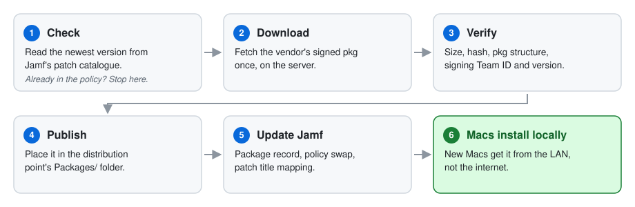

# jamf-dp-sync

**Download each app once, on your own server, and let every new Mac install it from the local network.**

[](https://github.com/kamaltaynaz/jamf-dp-sync/actions/workflows/tests.yml)
[](https://github.com/kamaltaynaz/jamf-dp-sync/releases)

[](LICENSE)

jamf-dp-sync is a small agent that runs from cron on a Linux Jamf Pro **file share distribution
point** and turns it into a **local cache for Mac builds**. It keeps the apps your enrollment
workflow installs current on that server, so they no longer come from the internet during a build.

## The problem

If you build several Macs at once, you may have watched it happen: the build is going well, then
Nudge or swiftDialog fails part-way through, on some Macs and not others.

Many enrollment workflows (for example [Jamf Setup Manager](https://github.com/jamf/setup-manager))
install apps with [Installomator](https://github.com/Installomator/Installomator) labels, and some
labels ask the GitHub API which release is newest. Anonymous GitHub API calls are limited to
**60 requests per hour per public IP address**. Every Mac behind the same NAT shares that limit, so
during a mass build the GitHub-backed labels start failing. Meanwhile every Mac downloads every
installer from the internet, every build, and some are several gigabytes each (Microsoft 365 and
Adobe Acrobat, for example).

Installomator did nothing wrong here. Downloading the latest version at install time is the right
design for most fleets, and the rate limit belongs to GitHub. jamf-dp-sync complements it: it moves
the download for the handful of apps every new Mac needs from "every Mac, at build time" to "one
server, once a night". It can even draft its configuration from Installomator labels.

## How it works

<picture>
  <source media="(prefers-color-scheme: dark)" srcset="docs/img/nightly-run-dark.svg">
  
</picture>

Each night, for each app you list, the agent reads the app's Jamf Patch Management title. If the
Jamf policy already holds that version, it stops: no download, no writes. Most nights every app
stops there and the whole run takes about a second.

When there is a new version, it downloads the vendor's signed installer pkg once, verifies it,
publishes it into the distribution point's `Packages/` folder, and swaps it into the policy your
enrollment workflow calls, leaving everything else in the policy as it was. It then prunes older
copies it created, keeping one for rollback, and posts one summary to Google Chat, Slack or
Microsoft Teams if anything changed or failed.

The full sequence is in [How it works](docs/how-it-works.md).

## What it checks before anything is published

Any failed check stops that app before the distribution point or Jamf is touched. The other apps
carry on.

- **Size and SHA-256**, where the vendor publishes them.
- **A valid flat pkg**: the archive structure and its checksum.
- **The signing certificate**: a "Developer ID Installer" certificate from the Apple Team ID you
  expect for that app.
- **The version inside the pkg**, so a stale or mismatched download is caught.

It also never touches what it didn't create. Only files with the agent's name prefix **and** a
marked Jamf package record are ever pruned, so hand-uploaded packages are safe.

## Quick start

You need a Linux server hosting a Jamf file share distribution point, Python 3.6 or later
(standard library only: no pip, no virtualenv) and `openssl`. The agent runs as an ordinary service
user and never needs root.

1. Follow [the install guide](docs/install.md): service user, write access to `Packages/`, staging
   folder, code, secrets, config, a Jamf API client and one policy per app.
2. Describe your apps in `packages.json` ([configuration](docs/configuration.md)), or draft the
   entries from [Installomator labels](docs/installomator-labels.md).
3. Check and try it, as the service user:

   ```
   python3 /opt/jamf-dp-sync/jamf_dp_sync.py check-config
   python3 /opt/jamf-dp-sync/jamf_dp_sync.py notify-test
   python3 /opt/jamf-dp-sync/jamf_dp_sync.py run --dry-run
   python3 /opt/jamf-dp-sync/jamf_dp_sync.py run
   ```

4. Add the daily cron line, then point your enrollment workflow at the policies
   ([Setup Manager and other workflows](docs/setup-manager.md)).

A dry run resolves, downloads and verifies, then prints what would change. It writes nothing to
`Packages/`, Jamf or the local cache.

## Known limits

Stated plainly, so you can decide whether it fits. The detail for each is in
[Known limits and compatibility](docs/known-limits.md).

- **The signature check reads certificate fields; it is not cryptographic.** It catches a wrong or
  unexpected vendor pkg, but it does not verify the signature chain to Apple's root the way
  `pkgutil --check-signature` does on macOS. macOS's installer still checks the real signature when
  a Mac installs the pkg.
- **Policy edits are last-writer-wins.** Jamf's Classic API has no conditional update. The agent
  re-reads each policy just before writing and reads it back just after, and warns if something
  changed, but an admin edit made in that instant can still be lost. Schedule runs for a quiet hour.
- **Signed vendor pkgs only**, directly or inside a DMG. It never repackages an `.app` bundle.
- **Some DMGs cannot be opened on Linux.** 7-Zip cannot read every APFS disk image; a dry run tells you.
- **Local distribution point only.** Jamf Pro on-premises is tested in production. Jamf Cloud with
  an on-site file share distribution point is expected to work but not yet tested; reports welcome.

## Documentation

| | |
| --- | --- |
| [Install](docs/install.md) | Server setup, Jamf API role, first run and cron |
| [Configuration](docs/configuration.md) | Every `packages.json` setting |
| [Commands](docs/commands.md) | `run`, `status`, `check-config`, `notify-test`, `label-import` |
| [How it works](docs/how-it-works.md) | The run in detail, verification and recovery |
| [Features and requirements](docs/features.md) | The full list |
| [Installomator labels](docs/installomator-labels.md) | Drafting config entries with `label-import` |
| [Notifications](docs/notifications.md) | Google Chat, Slack and Microsoft Teams |
| [Setup Manager and other workflows](docs/setup-manager.md) | Pointing your enrollment at the policies |
| [Known limits and compatibility](docs/known-limits.md) | The limits above, in full |
| [How it compares](docs/comparison.md) | Installomator, AutoPkg and Munki |
| [Testing](docs/testing.md) | Running the test suite |
| [Code references](docs/code-references.md) | Spec sections and review findings cited in comments |

## Credits

Designed by Kamal Taynaz. Built with Claude Code (Anthropic) as the developer, with independent code
review rounds by OpenAI Codex.

Thanks to [Installomator](https://github.com/Installomator/Installomator), whose labels record the
vendor download sources and Team IDs this project builds on, and to
[Jamf Setup Manager](https://github.com/jamf/setup-manager).

## Licence

MIT. See [LICENSE](LICENSE).
